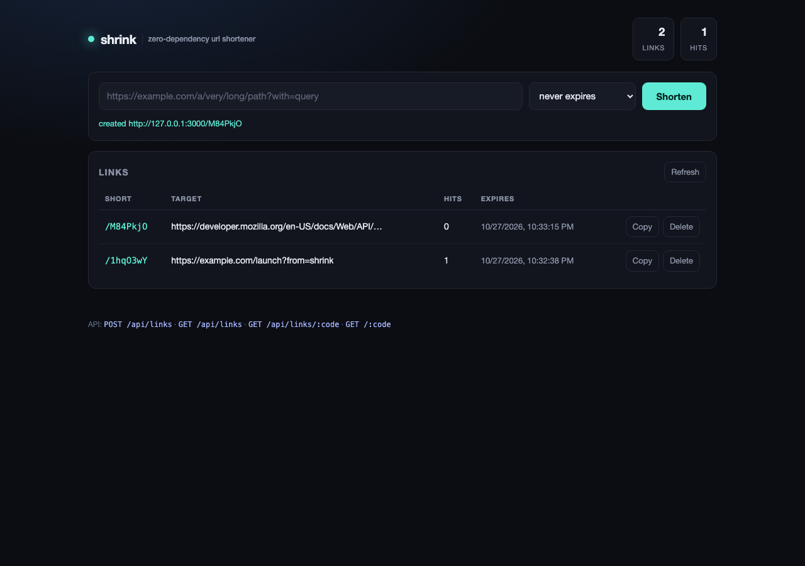

# shrink

零依赖的短链服务：文件持久化、点击统计、限流、内置 Web 面板。只用 Node 标准库，克隆下来直接跑，不需要 `npm install`。

## 快速开始

```bash
npm start                 # 默认 http://127.0.0.1:3000
npm start -- --port 8080  # 换端口
```

打开 <http://127.0.0.1:3000> 就是面板：粘贴长链接、一键复制短链、看点击数。



要求 Node >= 20（开发环境为 22.14）。

## API

| 方法 | 路径 | 说明 |
| --- | --- | --- |
| `POST` | `/api/links` | 创建短链，body `{ "url": "...", "ttlSeconds": 3600? }` |
| `GET` | `/api/links` | 列表 + 全局统计 |
| `GET` | `/api/links/:code` | 单条元数据与命中记录 |
| `DELETE` | `/api/links/:code` | 删除 |
| `GET` | `/api/stats` | `{ links, hits }` |
| `GET` | `/:code` | 302 跳转，并记录一次命中 |
| `GET` | `/healthz` | 存活探针 |

```bash
curl -s localhost:3000/api/links \
  -H 'content-type: application/json' \
  -d '{"url":"https://example.com/very/long/path","ttlSeconds":86400}'

# {"code":"aB3xY9k","url":"https://example.com/very/long/path","hits":0,
#  "expiresAt":1761560000000,"shortUrl":"http://127.0.0.1:3000/aB3xY9k", ...}

curl -i localhost:3000/aB3xY9k      # 302 -> 原始地址
curl -s localhost:3000/api/links/aB3xY9k | jq .hits
```

错误统一为 `{ "error": { "code", "message" } }`：`invalid_url`、`invalid_ttl`、`invalid_json`、`payload_too_large`、`not_found`、`rate_limited`、`method_not_allowed`。

## 设计取舍

- **持久化**：单个 JSON 快照，写入先落唯一临时文件再 `rename`，崩溃不会截断数据；每 250ms 合并刷盘，`SIGINT`/`SIGTERM` 时强制刷盘退出。适合单机小流量，不是多机方案。
- **短码**：`crypto.randomInt` 从 62 进制字母表取 7 位（约 3.5e12 组合），插入时最多重试 8 次避让碰撞。
- **过期**：`expiresAt` 是绝对毫秒；读取、列表、统计时惰性清理，不跑后台定时器。
- **统计**：每链累计 `hits`、最近 20 条命中（带 referer/UA）、referer 来源 Top 10。
- **限流**：进程内固定窗口，按 socket 地址对创建接口限 30 次/分钟，超限返回 429 + `Retry-After`。
- **HEAD**：返回与 GET 相同的头，但不算命中、不发 body。

## 测试与基准

```bash
npm test        # 14 个用例：store 单测 + 真实 HTTP 集成测试
npm run bench   # 压测创建与跳转，输出 p50/p95/p99
```

测试覆盖：短码生成、命中统计与截断、TTL 边界、快照往返、损坏文件拒绝启动、校验失败、404/405、限流、重启后数据不丢。

## 目录

```
bin/shrink.js      CLI 入口（参数解析、优雅退出）
src/app.js         HTTP 路由、校验、错误模型、限流挂载
src/store.js       内存索引 + JSON 快照持久化
src/rate-limit.js  固定窗口限流器
src/id.js          短码生成
public/index.html  面板（原生 JS，无构建）
test/              node:test 单测与集成测试
scripts/bench.js   in-process 基准
```

## 限制

- 单进程内存索引 + 单文件存储，不支持水平扩展。
- 限流以 `remoteAddress` 为准，反向代理后需改为解析可信的 `X-Forwarded-For`。
- 短码不校验目标可达性，也不做恶意链接黑名单。
